# Rose Meridian Omarchy Theme

A dusty-rose Omarchy theme about a small figure standing under three suns. The palette comes from the sunrise over the pyramid in the VR game of Netflix's *3 Body Problem* and from the wallpapers themselves: a near-neutral shadow ground, text in the sun's own cream, and one warm family from deep rose to apricot. The sun disc is the theme's object: it frames the focused window corner to corner, and the selected menu row stands between two of its pillars.

## Preview

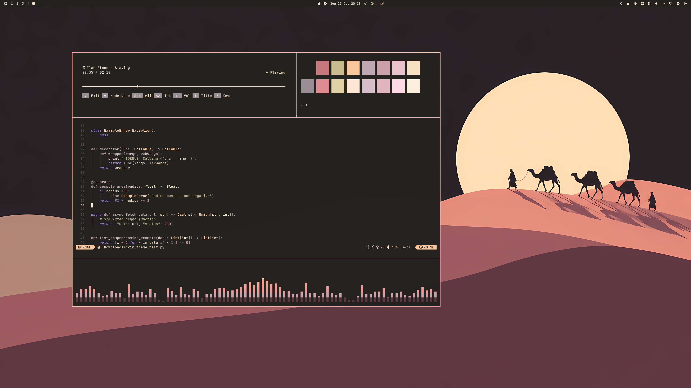

<table>
  <tr>
    <td>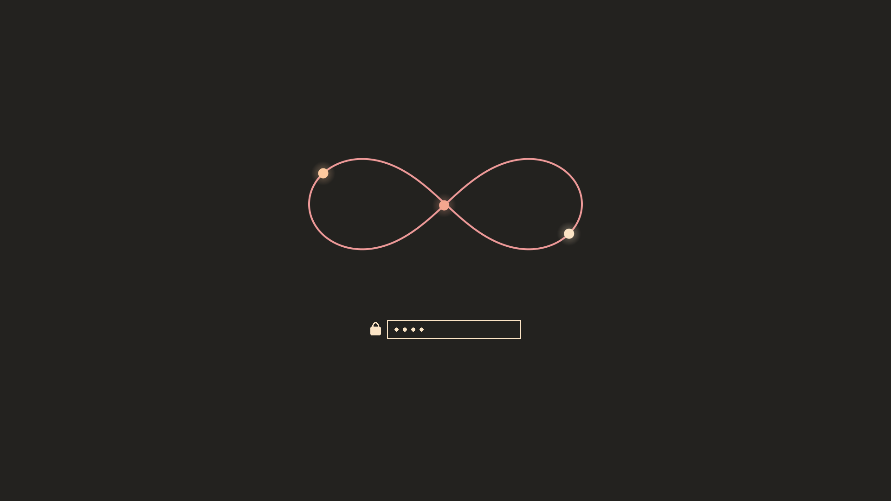</td>
  </tr>
</table>

## Install

```bash
omarchy theme install https://github.com/Devis99/omarchy-rose-meridian-theme
```

## What's Included

- Core Omarchy colours, a sun-disc window border (rose, cream, rose) and a matching bar, menu, launcher and popups.
- App themes for Discord (Vencord), GTK, Zen, Zed, btop, cava and cliamp, plus Yaru-red icons.
- A figure-eight Plymouth unlock logo and a 10-wallpaper set in `backgrounds/`.
- The palette as a Base24 scheme in `rose-meridian-base24.yaml`.

## Palette

The ground, text and accent are measured from two stills of the pyramid at sunrise: the shadow of the pyramid and a dead tree, the cream core of the sun and its rose rim. Every other colour is measured from the wallpapers, which share one family of mauve, rose, salmon, apricot and cream. Nothing is invented to fill a slot: there are no greens, blues or violets, so the terminal colours are one warm family separated by lightness.

It is a dark theme that stays soft rather than neon. The sun's cream is the only bright light on screen, and the rose of its rim is the only accent.

## Wallpapers

All wallpapers are 3840x2160, generated with AI (Codex image generation) in a flat poster style and upscaled. They contain no frames from the series; this is an unofficial fan theme, and *3 Body Problem* belongs to Netflix and the original novels to Liu Cixin. Scene notes are in `backgrounds/SOURCES.md`.

<table>
  <tr>
    <td>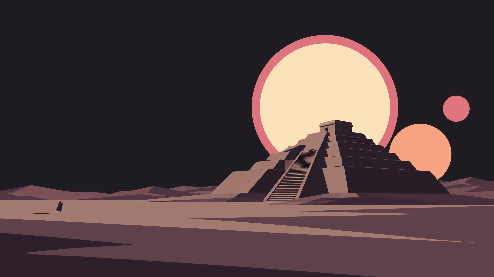<br><sub>01 Pyramid</sub></td>
    <td>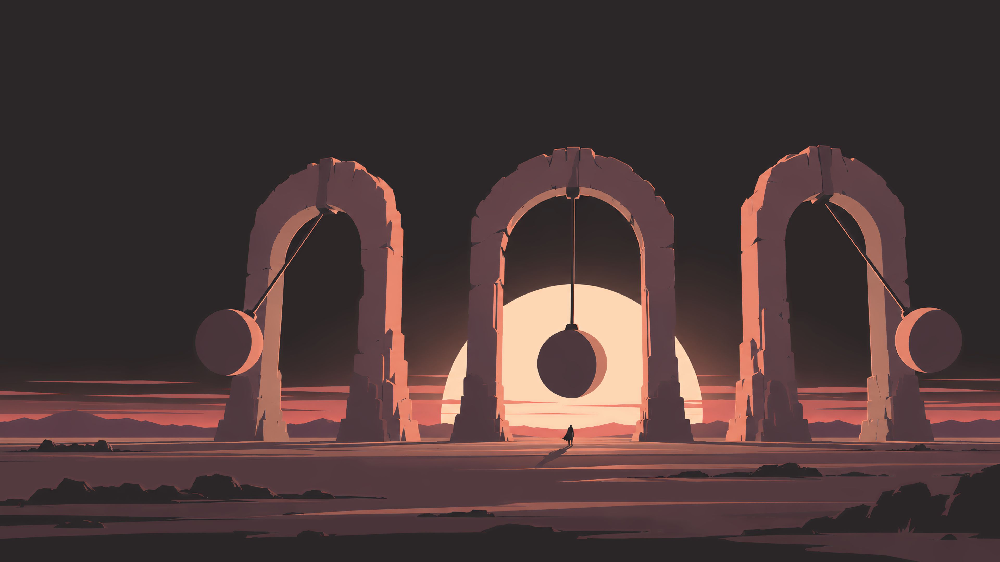<br><sub>02 Pendulums</sub></td>
    <td>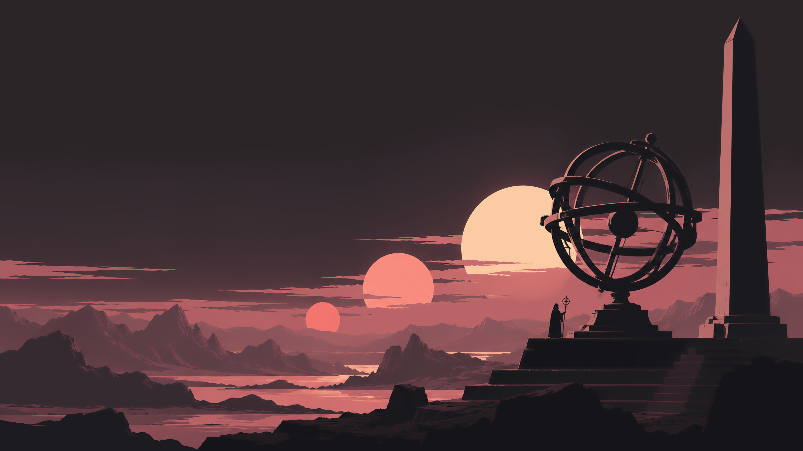<br><sub>03 Observatory</sub></td>
  </tr>
  <tr>
    <td>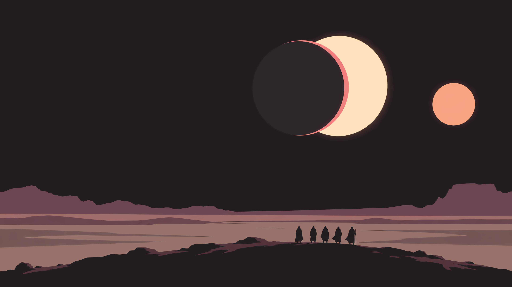<br><sub>04 Eclipse</sub></td>
    <td>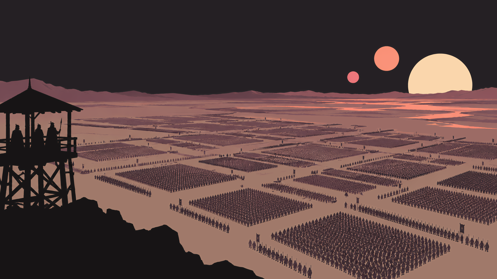<br><sub>05 Human Computer</sub></td>
    <td>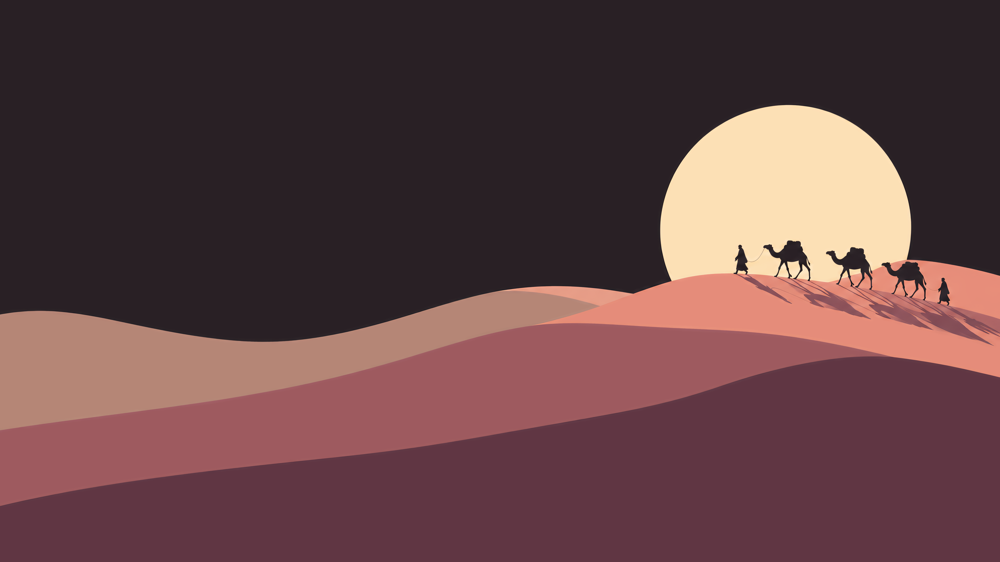<br><sub>06 Stable Era</sub></td>
  </tr>
  <tr>
    <td>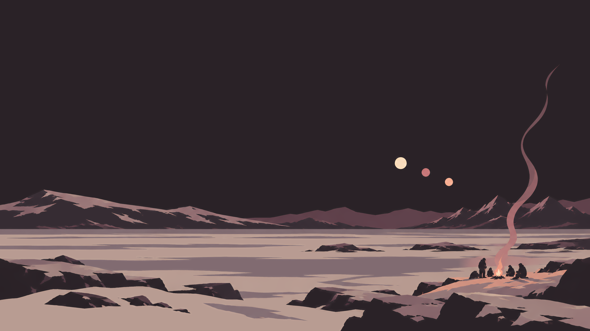<br><sub>07 Flying Stars</sub></td>
    <td>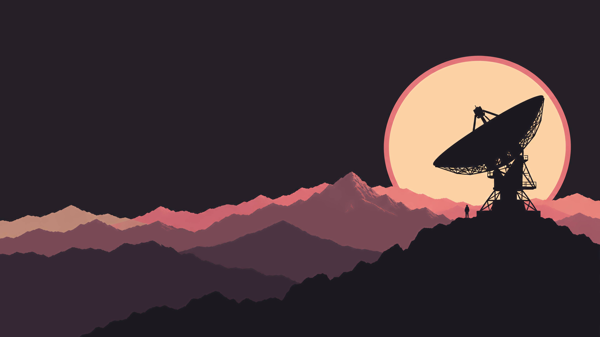<br><sub>08 Red Coast</sub></td>
    <td>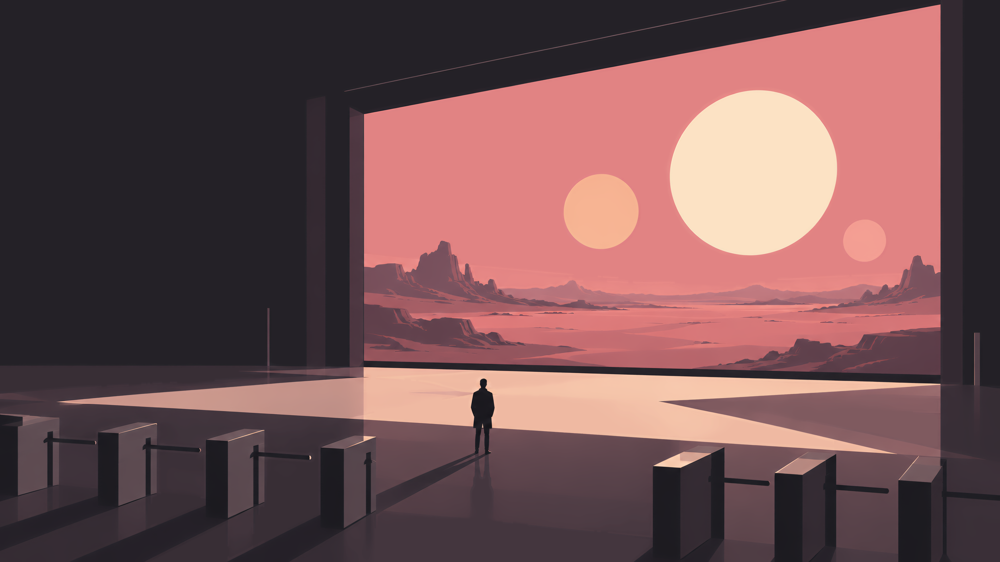<br><sub>09 Screen Hall</sub></td>
  </tr>
  <tr>
    <td>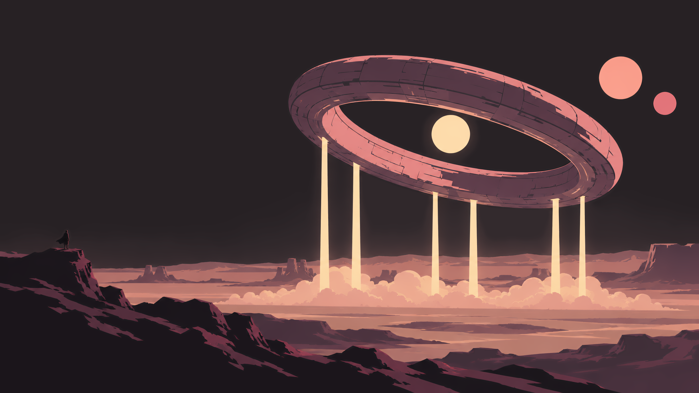<br><sub>10 Ring Ship</sub></td>
    <td></td>
    <td></td>
  </tr>
</table>
